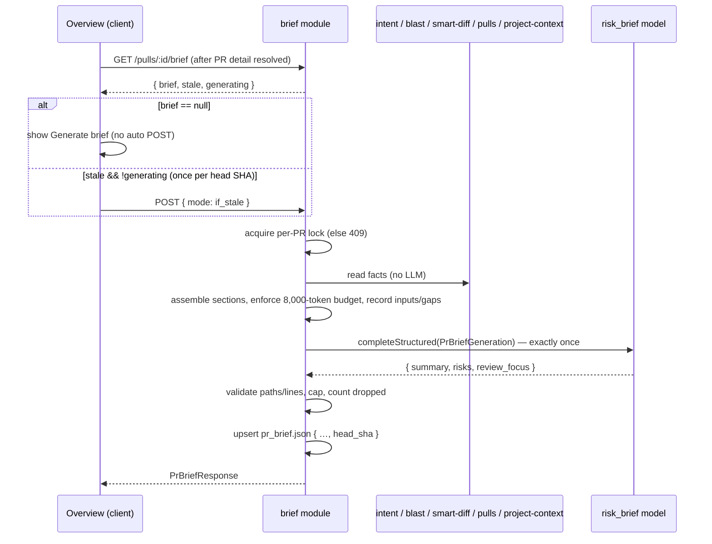

# Spec: PR Brief   |   Spec ID: SPEC-02   |   Status: approved
Modules: server (new `brief` module; reads `intent`, `blast`, `smart-diff`, `pulls`, `project-context`, `settings/feature-models`; `@devdigest/shared` contracts in `server/src/vendor/shared/contracts/brief.ts`), client (Overview tab → new PR Brief card + VerdictBanner, Files changed tab deep-link, `client/src/vendor/shared/contracts/brief.ts`, `client/messages/en/brief.json`)
Supersedes: —

## Problem and why

Reviewers often open someone else's PR "cold". They don't know why the change
exists, what is risky, or which file to read first. DevDigest already computes
parts of the answer separately:

- **Intent** (L03): `pr_intent`, `GET /pulls/:id/intent`, shown by `IntentCard`.
- **Smart Diff** (L03): role groups, `GET /pulls/:id/smart-diff`.
- **Blast Radius** (L04): `GET /pulls/:id/blast`, shown by `BlastRadiusCard`.

Nothing combines these into one orienting view, and nothing tells the reviewer
*which risks* matter or *where to start*.

This feature adds a **PR Brief** card at the top of the PR **Overview** tab.
It shows a short summary, **Risk areas** (each tied to a file) and
**Review focus** (`file:line — why`). It is produced by **exactly one** model
call. The model receives facts the system has already computed (intent, blast
summary and caller locations, diff statistics and changed line ranges, PR
description, linked issue, attached project specs). It never receives diff code.

There are two reasons the model gets facts instead of code:

- A bounded, pre-digested input keeps cost and latency predictable (8,000-token
  budget).
- Every file and line the model returns can be checked against a known set,
  so invented paths are discarded.

The brief is cached per PR together with the commit SHA it describes. It is
regenerated automatically the first time the PR is opened after a new commit,
and on demand from a refresh button.

## Goals / Non-goals

**Goals**

- G1. A new server `brief` module with `GET /pulls/:id/brief` (cached brief,
  no model call) and `POST /pulls/:id/brief` (generate).
- G2. Deterministic, budgeted input assembly from existing facts, with
  recorded provenance and recorded truncation. No diff hunk bodies.
- G3. One `completeStructured` call per generation. The model is resolved from
  the `risk_brief` feature-model setting.
- G4. Post-call validation drops any risk, file reference or focus item that
  points outside the PR's files or the blast-radius map, or outside the
  changed line ranges.
- G5. The brief is persisted in `pr_brief.json` with the head SHA. A new commit
  makes it stale, and the client then regenerates it automatically.
- G6. Overview UI: PR Brief card (summary, data-gaps note, Risk areas, Review
  focus) on top, with the existing `IntentCard` and `BlastRadiusCard` below it,
  unchanged. A VerdictBanner from the latest review sits above the card.
- G7. Clicking a Review focus item or a risk's file opens **Files changed** at
  that file, scrolled to the exact line when one is given.
- G8. `PrBrief` contract is extended in **both** vendored copies of `brief.ts`.

**Non-goals**

- NG1. The brief never derives intent. Intent derivation stays with
  `IntentCard` and the review path. The brief uses only an existing `ready`
  intent (user decision Q5). This keeps exactly one model call per generation.
- NG2. The model never receives diff hunk bodies (added, removed or context
  lines). Only paths, counts, roles and line-range numbers from hunk headers
  are sent.
- NG3. **PR history** ("Prior PRs touching these files") is not computed. The
  `history` field is always `{ history: [] }`.
- NG4. The existing `IntentCard` and `BlastRadiusCard` are not redesigned or
  merged into the brief card (user decision Q6). Their own actions (derive
  intent, Tree/Graph) are unchanged.
- NG5. Review findings from agent runs are not model input to the brief. The
  VerdictBanner only *displays* the latest review next to the brief.
- NG6. No new per-brief document picker. Specs come from the existing agent
  and skill attachments (user decision Q1).
- NG7. No streaming or SSE progress for generation. The POST is a single
  request/response.
- NG8. No automatic retry loop after a failed generation. Auto-regeneration is
  attempted at most once per head SHA per page load (AC-24).
- NG9. CI/MCP surfaces are not changed.
- NG10. The diff viewer is not redesigned. A simple file list with the target
  file expanded and highlighted is acceptable.

## User stories

- US-1. As a reviewer, when a PR has no brief, I see a PR Brief block with a
  **Generate brief** button on Overview.
- US-2. As a reviewer, I click Generate brief, wait while a skeleton is shown,
  and then see the brief: summary, Risk areas and Review focus. Intent and
  Blast radius are shown below it.
- US-3. As a reviewer, in Risk areas I see each risk with a title, a severity
  and the file(s) it relates to. I can expand a risk to read its explanation
  and click its file to open it in Files changed.
- US-4. As a reviewer, in Review focus I see `file:line — why it matters`.
  Clicking an item opens Files changed at that file and line.
- US-5. As a reviewer, when I reload the page I see the same brief immediately,
  with no regeneration.
- US-6. As a reviewer, I press a refresh button to regenerate the brief.
- US-7. As a reviewer, the first time I open a PR after a new commit, the brief
  regenerates automatically while the previous one stays visible.
- US-8. As a reviewer, I can see which input data the brief was generated
  without (e.g. no intent, degraded blast radius, no linked issue).
- US-9. As a reviewer, I see the latest review's verdict and PR score above the
  brief.
- US-10. As an operator, I can confirm from logs that each generation makes
  exactly one model call within the stated input budget and sends no diff code.

## Acceptance criteria (EARS)

### Contract (`@devdigest/shared`, both copies)

- **AC-1.** The shared `brief.ts` contract shall define
  `ReviewFocusItem = { file: string, line: int ≥ 1, reason: string }`. It shall
  also extend `PrBrief` with `summary: string` and
  `review_focus: ReviewFocusItem[]`. The server and client copies of `brief.ts`
  shall be byte-identical after the change.
  Verify: unit (contract test) parses a fixture with `summary` and
  `review_focus`; `diff server/src/vendor/shared/contracts/brief.ts client/src/vendor/shared/contracts/brief.ts` is empty.
- **AC-2.** `PrBrief` shall have the following fields:
  - `intent: Intent | null`
  - `blast: BlastRadius | null`
  - `risks: Risks`
  - `history: PrHistory`
  - `summary`
  - `review_focus`
  - `head_sha: string`
  - `generated_at: string` (ISO)
  - `provider`, `model`
  - `tokens_in`, `tokens_out`
  - `cost_usd: number | null` (null = unknown)
  - `attempts: int`
  - `data_gaps: DataGap[]`
  - `inputs: InputSection[]`
  - `dropped: { risks: int, risk_file_refs: int, review_focus: int }`

  Shapes are listed under Contracts.
  Verify: unit — a brief with `intent: null` and `blast: null` parses, and a
  brief missing `head_sha` fails.
- **AC-3.** The model-output schema (`PrBriefGeneration`) shall be
  `{ summary: string, risks: Risk[], review_focus: ReviewFocusItem[] }`, with
  every field required and no optional fields, so it works with strict
  structured output.
  Verify: unit — schema rejects an object without `review_focus`.

### Read (GET)

- **AC-4.** WHEN `GET /pulls/:id/brief` is called, the server shall return
  `PrBriefResponse = { pr_id, current_head_sha, brief: PrBrief | null, stale: boolean, generating: boolean }`
  from the database only, with zero model calls and zero GitHub calls.
  Verify: integration — with a mock LLM and mock GitHub, GET returns the stored
  brief and both call counters stay 0.
- **AC-5.** The server shall compute `stale` as `true` iff a brief exists and
  `brief.head_sha` differs from the PR's persisted `head_sha`. `stale` shall be
  `false` when `brief` is null.
  Verify: integration — store a brief for `abc`, update the PR head to `def`,
  and GET returns `stale: true`.
- **AC-6.** WHILE a generation for the PR is in progress, `GET` shall return
  `generating: true`.
  Verify: integration — hold the mock LLM open, GET in parallel, and the
  response has `generating: true`.
- **AC-7.** IF the PR does not exist in the caller's workspace, THEN both
  `GET` and `POST /pulls/:id/brief` shall respond 404. A non-uuid `:id` shall
  get the same validation error as other `/pulls/:id/*` routes.
  Verify: integration — PR of another workspace → 404.

### Generate (POST)

- **AC-8.** WHEN `POST /pulls/:id/brief` is called with body
  `{ mode: "refresh" }` (the default when the body is empty), the server shall
  generate a new brief for the PR's current persisted `head_sha`, persist it,
  and return `PrBriefResponse` with the new brief and `stale: false`.
  Verify: integration — POST then GET return the same `generated_at`, and
  `head_sha` equals the PR head.
- **AC-9.** WHEN `POST /pulls/:id/brief` is called with `{ mode: "if_stale" }`
  and the stored brief is not stale, the server shall return the stored brief
  without calling the model.
  Verify: integration — fresh brief, POST `if_stale` → LLM call count 0 and
  unchanged `generated_at`.
- **AC-10.** WHEN `{ mode: "if_stale" }` is posted and no brief exists or the
  brief is stale, the server shall generate exactly as for `refresh`.
  Verify: integration — stale brief, POST `if_stale` → 1 model call and new
  `head_sha`.
- **AC-11.** IF a generation for the same PR is already in progress, THEN
  `POST` shall respond `409` with error code `brief_in_progress` and shall not
  start a second model call.
  Verify: integration — two concurrent POSTs → one 200, one 409, LLM call
  count 1.
- **AC-12.** `POST /pulls/:id/brief` shall be rate-limited to 10 requests per
  minute, the same limit as `POST /pulls/:id/intent/derive`.
  Verify: integration — the 11th POST within a minute → 429.
- **AC-13.** Each generation shall make exactly one `completeStructured`
  invocation with `schemaName: "PrBriefGeneration"`. Schema-repair reprompts
  inside that invocation are allowed and recorded in `attempts`.
  Verify: integration — mock LLM `completeStructured` call count = 1 per POST,
  and the stored `attempts` equals the mock's reported attempts.
- **AC-14.** The server shall take the provider and model for the call from
  the workspace `risk_brief` feature-model setting. When the setting is unset,
  it shall use the registry default. Model names shall not be hard-coded in
  the brief module.
  Verify: integration — set `feature_models.risk_brief = {provider:'openai', model:'x-test'}`;
  the captured request has `model: 'x-test'` and the brief stores
  `provider/model`.
- **AC-15.** IF the model call fails (provider error, timeout, missing API key,
  or schema validation still failing after repair attempts), THEN `POST` shall
  respond with a typed error `brief_generation_failed` whose message contains
  no secrets, and shall leave any previously stored brief unchanged. A failed
  brief shall never be persisted.
  Verify: integration — stored brief A, mock LLM rejects with
  `401 Bearer sk-…`, POST → error without `sk-`, GET still returns A.

### Input assembly (facts, provenance, budget)

- **AC-16.** The server shall assemble the model input only from these
  sections, in this priority order:
  1. `pr` — PR title (≤ 300 chars) and description (≤ 4,000 chars).
  2. `intent` — the stored intent if its status is `ready`: summary, in-scope,
     out-of-scope, risk areas, confidence, missing context.
  3. `diff` — for each changed file: path, Smart Diff role, additions,
     deletions, and new-side changed line ranges derived only from hunk
     headers. Files are sorted by additions + deletions, descending. The first
     100 files are listed individually, and the remainder is summarised as
     counts.
  4. `blast` — `summary`, `degraded`/`reason`, and the caller locations
     `{ symbol, file, line }` (≤ 50 callers, highest-ranked first).
  5. `linked_issue` — title, state and body (≤ 4,000 chars).
  6. `specs` — project documents (AC-19).

  Verify: unit — the assembled sections appear in this order, with these
  names, in the `inputs` list.
- **AC-17.** The assembled input shall never contain diff hunk body lines: no
  line from a patch that begins with `+`, `-` or a space, other than `@@`
  header numbers.
  Verify: integration — a fixture patch with the body line
  `+const MARKER_7f3a = 1;` → the captured request messages do not contain
  `MARKER_7f3a`, but do contain the file's range numbers.
- **AC-18.** The total estimated size of all messages sent (system + user),
  measured as ⌈characters / 4⌉ tokens, shall be ≤ **8,000 tokens**. WHEN the
  sections exceed the budget, the server shall do the following:
  - Fill the sections in AC-16 priority order.
  - Truncate the first section that does not fit to the remaining budget. A
    text section is cut at a character boundary. A list section is cut at an
    item boundary.
  - Drop every later section.
  - Record each section in `inputs` with status `used`, `truncated` or
    `dropped` and its `est_tokens`.

  Verify: unit — a fixture with 30k tokens of specs → total ≤ 8,000, `specs`
  is `truncated` or `dropped`, and `pr`/`intent`/`diff` are `used`.
- **AC-19.** The server shall collect `specs` as follows:
  - Take the effective attached-document list of every **enabled** agent in
    the workspace: each agent's own attachments, then those of its linked
    skills that are enabled both on the link and globally (SPEC-01 AC-24).
    Agents are taken in agent creation order.
  - De-duplicate, keeping the first occurrence.
  - Read each document from the clone of the **PR's repository**.
  - Include documents whole, in order, while they fit the remaining budget.
    Truncate the first one that does not fit, and drop the rest.
  - Record documents that are missing, larger than 64 KB or unreadable in
    `inputs` with that status, as SPEC-01 does, and skip them.

  Verify: integration — agent A (enabled) attaches `specs/a.md`, agent B
  (disabled) attaches `specs/b.md`, skill S on A attaches `specs/a.md` and
  `specs/c.md` → specs order `[a, c]`, `b` absent.
- **AC-20.** The server shall record a `DataGap` in `data_gaps` for each fact
  that was unavailable or degraded:
  - `intent` `missing`: never derived, or `failed`.
  - `intent` `stale`: derived for another SHA. The intent is still included,
    and the stale flag is passed to the model.
  - `blast_radius` `degraded`: the blast response is `degraded: true`, with
    its `reason`. Included as-is.
  - `blast_radius` `missing`: the blast service threw.
  - `linked_issue` `missing`: GitHub unavailable or no linked issue.
  - `specs` `missing`: no attached documents or no clone.
  - `pr_description` `missing`: empty body.
  - Any section that was `truncated` or `dropped` by the budget.

  The input shall also tell the model, as a plain-text note, which data is
  missing.
  Verify: integration — PR with no intent row and repo-intel flag off →
  `data_gaps` contains `intent/missing` and `blast_radius/degraded`.
- **AC-21.** WHERE neither intent nor blast radius is available, the server
  shall still generate a brief from the remaining sections.
  Verify: integration — no intent, blast service throws → POST 200 with
  non-empty `summary`.
- **AC-22.** The server shall store in `PrBrief.intent` and `PrBrief.blast`
  the snapshot of the intent and blast radius that was used as input (or
  `null`), as provenance.
  Verify: integration — the stored `brief.intent.summary` equals the intent
  row's summary at generation time.

### Output validation (no invented paths)

- **AC-23.** WHEN the model response is received, the server shall validate
  it in this order:
  1. Normalise each path: strip leading `./` and `/`. Matching is exact and
     case-sensitive.
  2. **Known files** = the PR's changed file paths ∪ the blast-radius caller
     and changed-symbol files (when blast was available).
  3. Remove each risk `file_refs` entry that is not a known file. Drop a risk
     whose `file_refs` becomes empty.
  4. Drop a Review focus item whose `file` is not a known file. Also drop it
     when its `line` is neither inside a changed new-side line range of that
     file (for PR files) nor equal to a caller line in that file from the
     blast map.
  5. Keep at most 8 risks, ordered by severity `high` → `medium` → `low`,
     keeping model order within the same severity. Keep at most 6 focus items
     in model order.
  6. Count every removed item in `dropped`.

  Verify: unit — a response with a risk referencing `src/ghost.ts`, a focus
  item `src/a.ts:999` outside ranges and one at `./src/a.ts:12` inside a range
  → risk dropped, `:999` dropped, `src/a.ts:12` kept, and `dropped` counts
  are 1/1/1 accordingly.
- **AC-23a.** IF every risk and focus item is dropped by validation, THEN the
  server shall still persist the brief with the summary and empty lists.
  Verify: unit — all-invalid response → brief saved, `risks.risks = []`,
  `review_focus = []`.

### Cache and auto-regeneration (client + server)

- **AC-24.** WHEN the Overview tab loads a brief response with `brief != null`,
  `stale: true` and `generating: false`, the client shall send **one**
  `POST /pulls/:id/brief` with `{ mode: "if_stale" }` for that `(prId, current_head_sha)`
  pair during that page load, including under React Strict Mode double
  effects. It shall not send another POST for the same pair after a failure.
  Verify: unit (RTL, mocked hooks) — stale response → POST called once with
  `if_stale`; a re-render or effect re-run does not call it again.
  Also manual: in `next dev`, push a commit, open Overview → the server log
  shows one generation.
- **AC-25.** IF the auto-regeneration POST returns `409 brief_in_progress`,
  THEN the client shall poll `GET /pulls/:id/brief` every 2 s until
  `generating: false`, then render the result.
  Verify: unit — 409 then GET `generating:false` → new brief rendered.
- **AC-26.** WHILE a regeneration (auto or manual) is in progress and a
  previous brief exists, the card shall keep showing the previous brief marked
  "Updating…", with a loading indicator and the refresh button disabled.
  Verify: unit (RTL) — pending mutation + existing brief → previous summary
  visible, refresh button `disabled`.
- **AC-27.** WHEN the page is reloaded and the stored brief is not stale, the
  card shall render the stored brief from `GET` with no POST request.
  Verify: e2e — generate, reload → brief visible, and the network log shows
  no POST to `/brief`.
- **AC-28.** The client shall request the brief only after the PR detail
  (`GET /pulls/:id`, which refreshes `head_sha` from GitHub when possible) has
  resolved. The brief request shall be keyed by the PR's `head_sha`, so a
  changed head triggers a refetch.
  Verify: unit — the brief query is disabled until the PR detail is loaded;
  a changed `headSha` prop refetches.
- **AC-29.** WHERE no brief exists, the client shall not auto-generate and
  shall show the Generate brief button (AC-31).
  Verify: unit (RTL) — `brief: null` → no POST and the button is visible.

### Overview UI

- **AC-30.** The Overview tab shall render, from top to bottom:
  1. the VerdictBanner (when AC-38 applies);
  2. the **PR Brief** card;
  3. the existing `IntentCard` and `BlastRadiusCard`, side by side in two
     columns when the viewport is ≥ 1,024 px wide, and stacked otherwise;
  4. the existing Description section.

  Verify: e2e / visual — order and two-column layout at 1,280 px.
- **AC-31.** WHILE no brief exists and none is generating, the PR Brief card
  shall show the `unavailable` text and a **Generate brief** button. Clicking
  it shall send `POST { mode: "refresh" }`.
  Verify: unit (RTL) — click → mutation called with `refresh`.
- **AC-32.** WHILE the first generation (no previous brief) is in progress,
  the card shall show a skeleton in place of summary, Risk areas and Review
  focus, and the Generate button shall be disabled.
  Verify: unit (RTL) — pending + `brief: null` → skeleton present, button
  disabled.
- **AC-33.** WHEN a brief is available, the card shall show:
  - the summary;
  - a data-gaps note listing each `data_gaps` entry in words (e.g. "Generated
    without: intent (not derived yet); blast radius degraded (index
    partial)"), omitted when the list is empty;
  - a header line "Generated for `<sha7>` · `<model>`" with the cost when
    `cost_usd` is not null;
  - a **refresh** icon button with an accessible name, which sends
    `POST { mode: "refresh" }`.

  Verify: unit (RTL) — fixture renders summary, gap text and sha7; clicking
  refresh calls the mutation with `refresh`.
- **AC-34.** The **Risk areas** list shall show each risk's title, its
  severity as an icon coloured by severity (high = critical colour,
  medium = warning colour, low = muted colour) plus a text/ARIA severity
  label, and each of its `file_refs`. WHEN the list is empty, it shall show
  the `noRisks` text.
  Verify: unit (RTL) — high-severity risk renders the critical colour token
  and `aria-label` containing "high"; empty → "No notable risks flagged."
- **AC-35.** WHEN the user activates a risk row (click, or Enter/Space), the
  row shall expand to show `explanation`, and activating it again shall
  collapse it. The control shall expose `aria-expanded`.
  Verify: unit (RTL) — click toggles explanation visibility and
  `aria-expanded`.
- **AC-36.** The **Review focus** list shall render each item as
  `` `file:line` — reason ``. WHEN the list is empty, it shall show "No
  review focus suggested."
  Verify: unit (RTL) — `src/config.ts:12 — live key committed` text present.
- **AC-37.** WHEN the user activates a Review focus item whose file is in the
  PR's changed files, the client shall switch to `?tab=diff&file=<url-encoded path>&line=<line>`.
  WHEN the user activates a risk file reference that is in the PR's changed
  files, it shall switch to `?tab=diff&file=<path>` (no line).
  Verify: unit — click → router called with the expected URL; e2e — the URL
  changes and the Files changed tab is active.
- **AC-38.** WHERE the PR has at least one review of kind `review` with a
  non-null verdict, the Overview tab shall render the existing `VerdictBanner`
  for the **latest** such review, with these values:
  - verdict, summary and score from that review;
  - `findingsCount` = its findings count;
  - `blockers` = its non-dismissed `CRITICAL` findings (same rule as the
    Agent runs tab).

  WHERE no such review exists, no banner shall render.
  Verify: unit (RTL) — two reviews → the banner shows the newer review's
  score; none → no banner.
- **AC-39.** IF a Review focus item's or risk's file is a known file but not
  in the PR's changed files (blast-radius-only), THEN the item shall render
  with the label "File not in this PR's diff" and shall not navigate.
  Verify: unit (RTL) — blast-only focus item shows the label; click does not
  call the router.
- **AC-40.** IF a manual or auto generation fails, THEN the card shall show an
  error message with the server's error text and a Retry button. It shall keep
  any previous brief visible. For a missing-key failure, it shall point to
  Settings › Risk Brief.
  Verify: unit (RTL) — rejected mutation → error text and Retry; previous
  summary still visible.
- **AC-41.** All block labels and fixed copy of the PR Brief card shall come
  from `client/messages/en/brief.json`. This reuses `block.intent`,
  `block.blast`, `block.risks`, `noRisks`, `unavailable` and
  `unavailableHint`, and adds new keys for the remaining copy (e.g. title,
  summary, review focus, generate, refresh, updating, gaps, not-in-diff,
  errors). The card shall contain no hard-coded user-facing strings.
  Verify: unit — the component renders the keys from a test message bundle;
  grep the component for literal English copy → none.

### Files changed deep-link

- **AC-42.** WHEN the Files changed tab is opened with a `file` query
  parameter that matches a changed file, the tab shall do the following in
  both "Smart order" and "Original order":
  - expand that file;
  - scroll it into view within 1 s of the diff rendering;
  - visually highlight its header for ≥ 2 s.

  Verify: e2e — open `?tab=diff&file=src/b.ts` on a 20-file PR → `src/b.ts`
  is expanded and inside the viewport.
- **AC-43.** WHEN a `line` parameter is also present and that new-side line
  is rendered in the file's diff, the tab shall scroll to that line and
  highlight it for ≥ 2 s. IF the line is not rendered, THEN it shall fall back
  to AC-42 behaviour.
  Verify: e2e — `&line=12` → the row for new line 12 is in the viewport with
  the highlight style; `&line=9999` → the file header is in view.
- **AC-44.** IF the `file` parameter does not match any changed file, THEN the
  Files changed tab shall show a "File not in this PR's diff" notice above the
  diff and otherwise render normally.
  Verify: unit (RTL) — unknown path → notice visible.

### Observability

- **AC-45.** For each generation, the server shall write one structured log
  entry before the call and one after it, both with `call: "pr_brief"`.
  - Before: `provider`, `model`, `sections` (name, status, est_tokens),
    `est_tokens` total and `budget: 8000`.
  - After: `tokens_in`, `tokens_out`, `cost_usd`, `attempts`, `duration_ms`
    and the `dropped` counts.

  No section text shall be logged.
  Verify: integration — inject the service logger; assert both entries and
  that the PR body text is absent from them.

## Edge cases

| # | Case | Expected behaviour |
|---|---|---|
| E1 | No intent row, or intent `failed` | Generated without intent; `data_gaps` intent/missing (AC-20, AC-21). |
| E2 | Intent derived for an older SHA | Included, flagged `stale` to the model and in `data_gaps` (AC-20). |
| E3 | Repo-intel flag off / index failed / partial | Blast included with `degraded`, or `missing` if the service throws; brief still generated (AC-20, AC-21). |
| E4 | No GitHub token / offline | `linked_issue` gap; PR head SHA is the last persisted one; brief still generated (AC-20, AC-28). |
| E5 | No enabled agents, no attachments, or repo not cloned | `specs` gap; brief still generated (AC-19, AC-20). |
| E6 | Very large PR (> 100 files, huge specs) | Diff list capped at 100 files and the rest counted; budget enforced and cuts recorded (AC-16, AC-18). |
| E7 | PR with 0 changed files | Brief with summary; every focus/risk item fails validation → empty lists (AC-23, AC-23a). |
| E8 | Binary or too-large file (patch null) | No line ranges; focus items on it are dropped unless the line matches a blast caller (AC-23); risks on it are kept (file-level). |
| E9 | Pure-deletion file (`+c,0` hunks) | No new-side ranges; focus items on it are dropped (AC-23); risks are kept. |
| E10 | Model invents a path or line | Dropped and counted (AC-23). |
| E11 | Model returns a path with `./` or a leading `/` | Normalised, then matched (AC-23). |
| E12 | Double-click on Generate / two tabs / Strict Mode double effect | Server lock → one call, 409 for the rest (AC-11); client sends one auto POST per head SHA (AC-24) and polls on 409 (AC-25). |
| E13 | New commit pushed **during** generation | Brief stored with the start-time SHA → next GET is `stale` → auto-regenerated on the next open (AC-5, AC-24). |
| E14 | Second tab opens after the first tab's auto-regen finished | POST `if_stale` finds a fresh brief → no model call (AC-9). |
| E15 | Model/provider failure or missing key | Previous brief kept, typed error, Retry, Settings hint (AC-15, AC-40). |
| E16 | Auto-regen fails | Previous (stale) brief stays visible with the error; no retry loop (AC-24, AC-40, NG8). |
| E17 | Prompt injection in PR body / issue / spec / intent text | Treated as data (see Untrusted inputs); output paths validated regardless (AC-23). |
| E18 | Focus file exists only in the blast map | "File not in this PR's diff", no navigation (AC-39). |
| E19 | Deep-link to an unknown file or out-of-hunk line | Notice (AC-44) / fall back to the file header (AC-43). |
| E20 | PR closed or merged | Brief works the same; head SHA comparison unchanged. |
| E21 | Long or unicode paths and reasons | Rendered as plain text, wrapping; full path in a `title` tooltip. |
| E22 | Schema-invalid model output | Repaired inside the single invocation (`attempts` > 1) or failed (AC-13, AC-15). |
| E23 | PR deleted | `pr_brief` row removed by cascade (existing FK). |

## Non-functional

- **Performance**
  - NFR-P1. `GET /pulls/:id/brief` shall respond in ≤ 200 ms p95 locally (DB
    read only, AC-4).
  - NFR-P2. Input assembly (excluding the model call and the GitHub
    linked-issue fetch) shall take ≤ 2 s for a PR with ≤ 300 files and
    ≤ 20 attached documents.
  - NFR-P3. The model call is bounded by the existing provider adapter
    timeout (60 s per attempt). The client shows the skeleton or "Updating…"
    state with no client-side timeout.
- **Cost**
  - NFR-C1. Exactly one `completeStructured` invocation per generation
    (AC-13).
  - NFR-C2. Input ≤ 8,000 estimated tokens (⌈chars/4⌉) (AC-18).
  - NFR-C3. Zero model calls on GET or on reload (AC-4, AC-27).
- **Security**
  - NFR-S1. All routes are workspace-scoped through the existing request
    context (AC-7).
  - NFR-S2. Untrusted text is delimiter-wrapped under the existing injection
    guard (see Untrusted inputs).
  - NFR-S3. Error messages are scrubbed of secrets (AC-15).
  - NFR-S4. Diff code never leaves the server in this feature (AC-17).
- **Accessibility**
  - NFR-A1. Generate, refresh, Retry, risk rows and focus items are keyboard
    operable with visible focus.
  - NFR-A2. Risk rows expose `aria-expanded` (AC-35).
  - NFR-A3. Severity is never conveyed by colour alone (AC-34).
  - NFR-A4. Focus items have accessible names containing `file:line`.
  - NFR-A5. The "Updating…" state is announced via `aria-live="polite"`.
- **Reliability / observability**
  - NFR-R1. A failed generation never corrupts or removes the cached brief
    (AC-15).
  - NFR-R2. Every generation logs request and response stats (AC-45).
- **Privacy**: no new third party. Data goes to the provider already
  configured for `risk_brief`, and less data is sent than for a review
  (no code).
- **i18n**: all copy comes from `brief.json` (AC-41).

## Inputs (provenance)

| Input | Provenance |
|---|---|
| PR title, description, head SHA | [persisted: `pull_requests` row, refreshed by `GET /pulls/:id` from GitHub when a token is set] |
| Changed files, additions/deletions | [persisted: `pr_files` rows (same data as `PrDetail.files`)] |
| Changed line ranges | [deterministic: parsed from `@@ -a,b +c,d @@` headers of persisted `pr_files.patch`; numbers only] |
| File roles | [reused: Smart Diff role grouping (L03), DB-only] |
| Intent | [reused: `pr_intent` row via the intent module (L03); `ready` only, staleness from `head_sha`] |
| Blast summary and callers | [reused: blast service behind `GET /pulls/:id/blast` (L04), in-process, no LLM] |
| Linked issue | [external: GitHub via the existing `PrDetail.linked_issue` resolution; absent offline] |
| Project specs | [reused: SPEC-01 agent/skill attachments (paths) + confined clone reads; union over enabled agents] |
| Model choice | [config: workspace `feature_models.risk_brief`, else `FEATURE_MODELS` default] |
| Token estimate | [deterministic: ⌈chars/4⌉, the heuristic used by prompt composition stats] |
| Summary, risks, review focus | [LLM: one `completeStructured` call, then deterministic validation (AC-23)] |
| Verdict banner data | [reused: latest `reviews` row of kind `review` + its findings, via existing `GET` reviews hook] |

### Contracts (behaviour-defining shapes)

```ts
ReviewFocusItem   = { file: string; line: number /* int ≥ 1 */; reason: string }
PrBriefGeneration = { summary: string; risks: Risk[]; review_focus: ReviewFocusItem[] }   // model output
DataGap           = { source: 'intent'|'blast_radius'|'linked_issue'|'specs'|'pr_description'|'budget';
                      status: 'missing'|'stale'|'degraded'|'truncated'|'dropped'; reason: string }
InputSection      = { name: 'pr'|'intent'|'diff'|'blast'|'linked_issue'|'specs';
                      ref: string | null;            // e.g. spec path; null for whole sections
                      status: 'used'|'truncated'|'dropped'|'missing'|'too_large'|'unreadable'|'unavailable';
                      est_tokens: number }
PrBrief = {
  intent: Intent | null; blast: BlastRadius | null; risks: Risks; history: PrHistory; // history always []
  summary: string; review_focus: ReviewFocusItem[];
  head_sha: string; generated_at: string;
  provider: string; model: string; tokens_in: number; tokens_out: number;
  cost_usd: number | null; attempts: number;
  data_gaps: DataGap[]; inputs: InputSection[];
  dropped: { risks: number; risk_file_refs: number; review_focus: number };
}
PrBriefResponse = { pr_id: string; current_head_sha: string; brief: PrBrief | null;
                    stale: boolean; generating: boolean }
```

- `GET  /pulls/:id/brief` → `PrBriefResponse` (AC-4…AC-7).
- `POST /pulls/:id/brief` body `{ mode?: 'refresh' | 'if_stale' }`
  (default `refresh`) → `PrBriefResponse` | `409 brief_in_progress` |
  `429` | typed error `brief_generation_failed` | `404`.
- Persistence: `pr_brief.json` holds one `PrBrief` per PR (upsert by
  `pr_id`). The SHA lives inside the JSON (`head_sha`). No new columns.
- Deep-link: `/repos/:repoId/pulls/:number?tab=diff&file=<url-encoded path>[&line=<int>]`.

### Module interaction

| Module | Owns | Contract used by brief | Failure at boundary |
|---|---|---|---|
| `brief` (new, server) | `pr_brief` row, input assembly, single model call, validation, generation lock | — | — |
| `intent` | `pr_intent` | read-only stored intent | missing/failed → gap; never derives (NG1) |
| `blast` / `repo-intel` | index, blast mapping | `BlastRadiusResponse` | degraded → included + gap; throws → `missing` gap |
| `smart-diff` | role grouping | file → role | error → files sent without a role; not a data gap |
| `pulls` | PR row, files, GitHub detail | head SHA, files, patches, linked issue | GitHub down → persisted data, `linked_issue` gap |
| `project-context` | attachments, confined reads | effective paths + read status | per-doc status recorded; never fails the brief |
| `settings` | feature models | `risk_brief` choice | no key → `brief_generation_failed` |
| client Overview | PR Brief card, VerdictBanner, auto-regen trigger | `PrBriefResponse` | error state + Retry (AC-40) |
| client Files changed | deep-link handling | `file`/`line` query | unknown file → notice (AC-44) |



## Untrusted inputs

- **PR title/description, linked issue text, spec documents, intent text**
  (intent is itself LLM output derived from PR text) are author-controlled
  data. Each is wrapped in its own `<untrusted source="…">` block, with closing
  tags escaped. They go into the user message under the existing SECURITY
  injection guard in the system prompt, never into the system instructions.
- **Model output** (summary, titles, explanations, reasons, paths) is
  untrusted:
  - paths and lines are validated against known sets (AC-23);
  - all text is rendered as plain React text nodes (no HTML/Markdown
    execution);
  - deep-link `file` values are URL-encoded and matched against PR files
    before any navigation (AC-37, AC-44).
- **Query parameters** `file`/`line` on Files changed are untrusted. An
  unknown file only shows a notice (AC-44), and a non-integer `line` is
  ignored.

## Traceability

| Story | ACs | Edge cases / NFRs | Source |
|---|---|---|---|
| US-1 generate when none | AC-29, AC-31, AC-32, AC-8 | E12, NFR-A1 | user text (stories); assignment P1 |
| US-2 see brief | AC-1–AC-3, AC-13, AC-14, AC-16–AC-19, AC-22, AC-30, AC-33 | E6, NFR-C1, NFR-C2, NFR-P2, NFR-P3 | user text; screenshot 1 |
| US-3 risks | AC-23, AC-23a, AC-34, AC-35, AC-37, AC-39 | E8–E11, E18, NFR-A2, NFR-A3 | user text; screenshot 1 "RISK AREAS"; P3 list |
| US-4 review focus + navigation | AC-23, AC-36, AC-37, AC-39, AC-42–AC-44 | E7–E11, E18, E19, NFR-A4 | user text; screenshots 1–2 |
| US-5 reload = cached | AC-4, AC-5, AC-27, AC-28 | NFR-P1, NFR-C3 | user text; assignment step 5 |
| US-6 refresh | AC-8, AC-11, AC-12, AC-26, AC-33, AC-15, AC-40 | E12, E15, NFR-R1 | user text |
| US-7 auto-regen after commit | AC-5, AC-6, AC-9, AC-10, AC-24, AC-25, AC-26, AC-28 | E12–E14, E16 | user decision Q4 |
| US-8 missing data | AC-20, AC-21, AC-33 | E1–E5 | assignment P1 ("states which data is lacking"); Q5 |
| US-9 verdict banner | AC-38, AC-30 | — | screenshot 1 banner; assignment P3; Q7 |
| US-10 operator audit | AC-13, AC-17, AC-18, AC-45, AC-7 | E17, E22, NFR-S1–S4, NFR-R2 | assignment P2 |

## [NEEDS CLARIFICATION]

None open. Resolved with the user on 2026-10-10:

- Q1 specs source: union of all enabled agents' effective attachments (AC-19).
- Q2 budget: 8,000 estimated tokens, priority order, cuts recorded (AC-16, AC-18).
- Q3 lines: changed line ranges from hunk headers + blast caller lines; out-of-range items dropped (AC-16, AC-23).
- Q4 stale: auto-regenerate on first open after a new commit (AC-24–AC-26).
- Q5 intent: `ready` only, never derived; stale intent flagged (AC-20, NG1).
- Q6 layout: new card on top, existing cards unchanged below; snapshot kept (AC-22, AC-30, NG4).
- Q7 P3 accepted: VerdictBanner (AC-38), risk expand (AC-35), risk → Files changed (AC-37), "File not in this PR's diff" (AC-39, AC-44), skeleton (AC-32); i18n labels per repo convention (AC-41).
- Non-blocking defaults accepted: N1 (AC-11, AC-12), N2 (AC-15, AC-40), N3 (AC-23), N4 (AC-37, AC-42, AC-43), N5 (AC-23), N6 (AC-16, E7), N7 = one `completeStructured` invocation with `attempts` logged (AC-13), N8 (Untrusted inputs).
